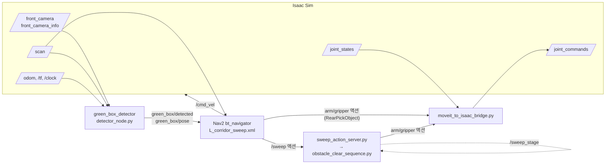
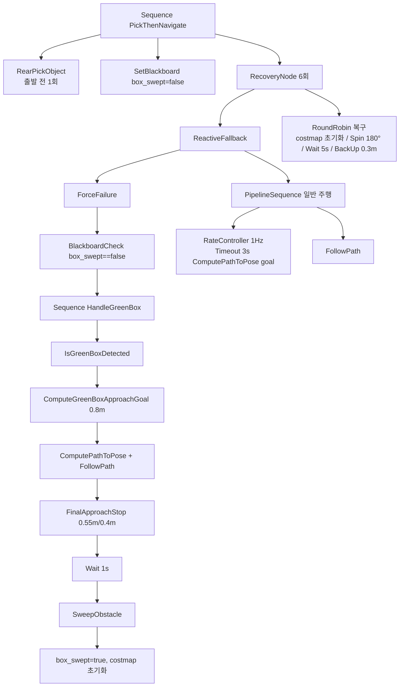

# 이동 매니퓰레이터의 장애물 처리 주행 프로젝트 보고서

- 저장소: `2026_industry_cowork` (main 브랜치, 최신 커밋 `23e4745 sim config edit`)
- 작성일: 2026-10-12
- 대상 기간: 2026-09-01 ~ 2026-10-01 (개발 세션 기록 14건)
- 작성 기준: **현재 코드(작업 트리)를 기준으로 서술**했습니다. 개발 세션에서 나온 값이 현재 코드와 다르면 "변경 이력"으로 따로 표기했습니다. 빌드 산출물(`build/`, `install/`, `log/`), rosbag(약 60 GB), 대용량 모델·가상환경(`local_llm/`, 약 5.7 GB)은 다루지 않았습니다.

---

## 요약

이 프로젝트는 **팔이 달린 소형 이동 로봇(TurtleBot3 + OpenMANIPULATOR-X)이 물건을 싣고 목적지로 가다가, 길을 막은 장애물을 스스로 찾아 팔로 치우고 주행을 이어 가는 기능**을 만드는 것입니다. 개발과 검증은 NVIDIA Isaac Sim 5.1 시뮬레이션에서 하고, 실제 로봇(라즈베리파이 기반 TurtleBot3)으로 옮기는 단계에 있습니다.

- **주행:** ROS 2 Humble의 Nav2와 Behavior Tree(BT.CPP v3)를 씁니다. 상황 판단과 동작 순서는 BT XML로 정의하고, 필요한 동작은 직접 만든 BT 플러그인 25종으로 구현했습니다.
- **인식:** 대형 AI 모델 없이 **색상(HSV) 분할과 2D 라이다를 결합**해 "초록 박스"(치울 수 있는 장애물)의 위치를 추정합니다. 처음에는 VLM, 이후 YOLO 계열을 검토했으나, 실행 환경 제약으로 경량 방식으로 정했습니다.
- **조작:** 출발 전 앞의 물체를 집어 로봇 뒤쪽에 싣고, 장애물 앞에서는 `/sweep` 액션 한 번으로 "싣고 있던 물체 내려놓기 → 팔로 장애물 쓸어내기 → 물체 다시 집기"를 수행합니다.
- **현재 성과(시뮬레이션):** 기준 배치에서 5회 연속 성공(5/5)했습니다. 인식 개선 후 박스 위치 추정 오차가 평균 0.14 m에서 약 0.04~0.06 m로 줄었습니다.
- **남은 과제:** 박스 위치가 바뀌면 성공률이 떨어지고(6개 배치 중 3개 성공), 실제 로봇에서는 카메라 타임스탬프 문제(약 471초 어긋남)로 인식이 동작하지 않는 상태입니다. 7장에 정리했습니다.

---

## 1. 프로젝트 개요

### 1.1 목표 시나리오 (현재 메인: `L_corridor_sweep.xml`)

1. 주행 목표를 받으면, 출발 전에 로봇 앞의 물체를 집어 뒤쪽 운반 자세(`P_REAR_CARRY`)로 싣습니다.
2. ㄱ자 복도를 따라 목표로 주행합니다.
3. 주행 중 초록 박스가 **확정 검출**되면 박스 중심 0.8 m 앞 지점으로 이동합니다.
4. 박스 중심 0.55 m(또는 라이다 전방 0.4 m)까지 천천히 다가가 정지하고, 1초 대기합니다.
5. `/sweep` 액션을 호출합니다. 매니퓰레이터 쪽이 "뒤에 물체 내려놓기 → 박스 쓸어내기 → 후퇴 → 물체 다시 집기"를 수행합니다.
6. costmap을 비우고 목표까지 경로를 다시 계획해 도착합니다.

### 1.2 기술 스택

| 구분 | 사용 기술 |
|---|---|
| 미들웨어 | ROS 2 Humble |
| 주행 | Nav2 (Humble), AMCL, NavFn 전역 계획, DWB 지역 제어 |
| 행동 제어 | BehaviorTree.CPP v3, 자체 BT 플러그인(C++) |
| 팔 제어 | MoveIt 2 move_group, FollowJointTrajectory / GripperCommand 액션 |
| 시뮬레이션 | NVIDIA Isaac Sim 5.1 (WebRTC 스트리밍 및 headless) |
| 로봇 | TurtleBot3 + OpenMANIPULATOR-X (4축 팔 + 그리퍼), 2D 라이다, RealSense 계열 RGB-D 카메라 (시뮬레이션 모델: RSD455) |
| 인식 | OpenCV HSV 분할 + 라이다 점 투영 (Python, `green_box_approach`) |

---

## 2. 디렉토리 구조

빌드 산출물, rosbag, 모델·가상환경은 제외했습니다. `★` 표시는 이 프로젝트에서 직접 만든 부분입니다.

```
2026_industry_cowork/
├── README.md
├── isaac_sim_cmd_line.txt            ★ 초기(final.xml 시기) 실행 명령 메모
├── green_box_scenario_cmd_line.txt   ★ 현재 시나리오 실행 절차(터미널 T1~T8)
├── real.pgm / real.yaml              ★ 실제 환경 지도(미커밋, 0.05 m/px)
├── local_llm/                        로컬 LLM/VLM 실험용 가상환경 (git 제외, 5.7 GB)
├── rosbag2_2026_09_16-20_22_17/      주행 기록 (git 제외, 60 GB)
└── IsaacSim-ros_workspaces/          NVIDIA IsaacSim-ros_workspaces 기반
    ├── dockerfiles/                  Humble/Jazzy 빌드용 Dockerfile (원본)
    ├── jazzy_ws/                     Jazzy 워크스페이스 (원본, 미사용)
    ├── humble_ws_bttest/             BT 실험용 사본 (green box 플러그인 이전 버전)
    ├── students_ws/                  학생 팀 작업 공간
    │   ├── ai_festa_src/ai_festa_navigation/   AI Festa용 Nav2 launch·params
    │   ├── turtlebot3_ws/            실제 로봇용 스크립트(fixed_pick_place, fixed_sweep 등)
    │   └── turtlebot3_manipulation/  ROBOTIS 패키지 사본
    └── humble_ws/                    ★ 주 개발 워크스페이스
        └── src/
            ├── custom_nav2_bt_plugins/   ★ BT 플러그인 25종 + 인식 노드
            ├── green_box_approach/       ★ 초록 박스 검출 노드 (Python)
            ├── festa_manipulation/       ★ 팔 동작 스크립트 + Sweep 액션 정의
            │   ├── turtlebot3_msgs/          Sweep.action 포함 메시지 패키지
            │   └── festa_action/             sweep_action_server.py 등 (colcon 비대상)
            ├── moveit_to_isaac_bridge.py ★ MoveIt 액션 ↔ Isaac 관절 토픽 중계
            ├── fixed_pick_place.py, test_depth.py, reset_home.py   ★ 보조 스크립트
            ├── *.xml                     ★ BT 정의 (L_corridor_sweep.xml이 현재 메인)
            ├── *_nav2_params.yaml        ★ Nav2 파라미터 (L_corridor_nav2.yaml이 현재 메인)
            ├── *.yaml / *.pgm / *.png    ★ 지도 (L_corridor, demo, 1_obs, 2_obs 등)
            ├── *.usd                     ★ Isaac Sim stage (L_corridor_green_box.usd가 현재 메인)
            ├── turtlebot3_manipulation/  ROBOTIS 로봇 기술(URDF, MoveIt 설정, 하드웨어)
            └── isaacsim_bringup, isaac_tutorials, navigation, moveit, ...   NVIDIA 원본 예제
```

### 2.1 BT XML과 파라미터 파일의 관계

| BT XML | 시기 | 쓰는 params | 내용 |
|---|---|---|---|
| `L_corridor_sweep.xml` | 9/29~ (**현재**) | `L_corridor_nav2.yaml` | 출발 전 RearPick → 초록 박스 sweep → 목표 |
| `L_corrider.xml` | 9/29 | (보관) | sweep 이전 흐름: Place → Push 자세 → Pick → 10초 대기 |
| `final.xml` | 9/18~9/29 | `final_nav2_params.yaml` | 원점↔목표 무한 왕복, 각 구간에서 장애물 처리 |
| `demo.xml`, `demo_just_nav2.xml` | 9/13~9/15 | `demo_nav2_params.yaml` | 토픽 트리거 데모: 물체 내려놓기 → 몸체로 장애물 밀기 → 복귀·재집기 |
| `custom_bt_manipulator.xml` | 9/8~9/12 | `custom_nav2_params.yaml` | 출발 전 고정 pick + 장애물 법선 접근 |
| `custom_bt.xml` | 9/1~9/4 | `custom_nav2_params.yaml` | 최초 커스텀 BT (원본 보호 대상) |
| `place_object_example.xml` | 9/12 | — | 고정 좌표 이동 + Place 예제 |

---

## 3. ROS 2 패키지별 역할

### 3.1 패키지 구분

| 패키지 | 출처 | 역할 |
|---|---|---|
| `custom_nav2_bt_plugins` | 자체 개발 | Nav2 BT 플러그인 25종, RGB-D 장애물 위치 추정 노드, Perception Stabilizer |
| `green_box_approach` | 자체 개발 | HSV + 라이다 기반 초록 박스 검출 노드 (`detector_node`) |
| `festa_manipulation/turtlebot3_msgs` | ROBOTIS 패키지에 `Sweep.action` 추가 | 주행↔팔 연동 액션 인터페이스 |
| `festa_manipulation/festa_action` | 자체 개발 (실제 로봇 스크립트 사본) | Sweep 액션 서버, 장애물 제거 시퀀스 (패키지가 아니라 `python3`로 직접 실행) |
| `turtlebot3_manipulation` | ROBOTIS | URDF, MoveIt 설정, ros2_control 하드웨어 |
| `isaacsim_bringup`, `isaac_tutorials`, `navigation`, `moveit`, `isaac_ros2_messages`, `custom_message`, `isaac_compressed_image_decoder`, `ackermann_control`, `humanoid_locomotion_policy_example` | NVIDIA 원본 | Isaac Sim ROS 2 예제. 이 프로젝트에서 수정하지 않음 |

### 3.2 노드와 토픽 구성 (현재 시나리오)



| 토픽 / 액션 | 타입 | 발행·제공 | 사용 |
|---|---|---|---|
| `/front_camera`, `/front_camera_info` | Image, CameraInfo | Isaac Sim | detector |
| `/scan` | LaserScan | Isaac Sim (실기: LDS) | detector, Nav2, FinalApproachStop |
| `green_box/detected` | Bool | detector (이미지마다) | IsGreenBoxDetected |
| `green_box/pose` | PoseStamped (map) | detector (확정 프레임만) | IsGreenBoxDetected, ComputeGreenBoxApproachGoal, FinalApproachStop |
| `green_box/debug_image` | Image (best effort) | detector | 튜닝용 화면 |
| `/arm_controller/follow_joint_trajectory` | FollowJointTrajectory 액션 | bridge | RearPickObject, sweep 시퀀스 |
| `/gripper_controller/gripper_cmd` | GripperCommand 액션 | bridge | RearPickObject, sweep 시퀀스 |
| `/sweep` | turtlebot3_msgs/Sweep 액션 | sweep_action_server | SweepObstacle |
| `/sweep_stage` | String | obstacle_clear_sequence.py | sweep 서버 결과 판정, 모니터링 |
| `/cmd_vel` | Twist | Nav2 controller, FinalApproachStop | 로봇 베이스 |

### 3.3 `custom_nav2_bt_plugins`

Nav2 Humble이 쓰는 BT.CPP v3용 플러그인 묶음입니다. 플러그인마다 공유 라이브러리를 하나씩 만들고, Nav2 파라미터의 `plugin_lib_names`에 이름을 올려 로드합니다. 팔·주행 동작은 모두 `StatefulActionNode`로 만들어, 팔이 움직이는 동안에도 BT 틱이 막히지 않습니다.

#### (1) 현재 시나리오에서 쓰는 플러그인

| 노드 (XML 이름) | 종류 | 하는 일 | 주요 포트 (현재 XML 값) |
|---|---|---|---|
| `RearPickObject` | 상태 액션 | 앞 물체 집기 → 들기 → 옆 운반 → 뒤쪽 운반 자세(`P_REAR_CARRY`). 시작 시 이미 `P_REAR_CARRY`(오차 0.12 rad 이내)면 움직이지 않고 SUCCESS 처리해 물체를 떨어뜨리지 않음 | `arm_move_time` 4.0 s, `grasp_position` 0.002, `step_timeout` 15 s, `server_timeout` 5 s |
| `IsGreenBoxDetected` | 조건 | 마지막 `detected`가 true이고 pose가 `max_age` 이내면 SUCCESS | `max_age` 1.0 s |
| `ComputeGreenBoxApproachGoal` | 동기 액션 | 로봇→박스 직선상에서 박스 중심 `standoff_distance` 앞 지점, 박스를 바라보는 방향으로 목표 생성. 이미 그 안쪽이면 현재 위치 유지 | `standoff_distance` 0.8 m, `global_frame` map |
| `FinalApproachStop` | 상태 액션 | Nav2 계획기를 거치지 않고 `/cmd_vel`로 박스 쪽으로 회전·조향하며 천천히 전진. 시작 시 받은 박스 pose를 고정해 쓰고, 박스 중심까지 거리 또는 라이다 전방 최소 거리 중 먼저 걸리는 조건에서 정지 | `stop_center_distance` 0.55 m, `stop_distance` 0.4 m, `lidar_confirm_scans` 3, `approach_speed` 0.15 m/s, `front_half_angle` 0.26 rad, `scan_loss_timeout` 0.5 s, `time_allowance` 30 s |
| `SweepObstacle` | 상태 액션 | `/sweep` 액션 클라이언트. `result_code == "SUCCESS"`일 때만 SUCCESS. 서버가 없어도 트리 로드는 실패하지 않도록 클라이언트를 지연 생성 | `server_timeout` 5 s, `accept_timeout` 5 s, `sweep_timeout` 120 s |

#### (2) 이전 시나리오에서 만든 플러그인 (현재 빌드·등록은 유지)

| 분류 | 노드 | 하는 일 |
|---|---|---|
| 팔 고정 시퀀스 | `FixedPickObject` | 열기 → home → pre_pick → pick → 잡기 → 들기 → 운반 (fixed_pick_place.py 이식) |
| | `PlaceObject` | 같은 자세로 앞에 내려놓고 home 복귀 |
| | `PushObstacle` / `RetractArm` | 팔을 밀기 자세로 펴서 유지 / home으로 회수 |
| 지정 좌표·트리거 | `SetFixedGoal` | XML에 적은 map 좌표를 목표 포트로 출력 |
| | `TopicTrigger` | Bool 토픽의 false→true 전환마다 한 번만 SUCCESS |
| 경로 보정 | `OrientPathToYaw` | 경로 마지막 구간을 목표 yaw의 직선으로 다시 만들어, 끝에서 제자리 회전 없이 정렬 |
| | `ComputeStraightPathToPose` | 전역 계획기 없이 현재 위치→목표 직선 경로 생성 |
| 개루프·odom 주행 | `OpenLoopDrive` | 충돌 검사 없이 시간 기반 직진·후진 |
| | `OdomLimitedDrive` | odom으로 잰 실제 이동 거리만큼 직진 (밀기용) |
| | `RecordOdomPose` / `RecordMapPose` | 현재 odom / AMCL pose 기록 |
| | `DriveToRecordedPose` | 기록한 위치까지 odom 피드백으로 후진 후 yaw 보정 |
| | `WiggleInPlace` | 좌우로 작게 회전해 AMCL 수렴 보조 |
| 장애물 인식 연동 (VLM 시기) | `IsMovableObstacleDetected` | `/obstacle/is_movable` Bool 확인 |
| | `IsObstacleTracking` | `/perception_state == TRACKING` 확인 (없으면 Bool로 대체) |
| | `LockApproachPose` | 장애물 pose를 한 번 고정 |
| | `CaptureInitialPath` | 우회 전 최초 경로를 저장 |
| | `ApproachObstacleNormal` | 장애물 표면 법선 방향으로 standoff 지점까지 직선 접근 경로 생성 |
| | `WaitForObstacleClearance` | 장애물이 치워졌다는 신호(또는 timeout)까지 대기 |

#### (3) 인식 노드 (현재 시나리오에서는 실행하지 않음)

- `rgbd_obstacle_localizer` (C++): pluginlib 기반 `MovableObstacleLocalizer` 구현(`DepthCentroidLocalizer`)을 불러, depth 영상 중앙 ROI의 가장 가까운 덩어리 중심을 map 좌표로 발행합니다.
- `perception_stabilizer.py`: VLM 검출 신호와 depth를 받아 IDLE/CANDIDATE/TRACKING 상태기계, 누적 점군 PCA로 장애물 중심과 표면 법선을 안정화해 `/perception_state`, `/obstacle_pose_stable`로 발행합니다. `centroid_source`(`buffer` | `latest_frame`) 파라미터로 위치 계산 방식을 고릅니다.

### 3.4 `green_box_approach` (초록 박스 검출)

`detector_node.py`는 ROS 입출력만 맡고, 계산은 ROS 의존성이 없는 `geometry.py`에 모았습니다. `geometry.py`는 단위 테스트 31건(`test/test_geometry.py`)으로 검증합니다.

**한 프레임의 처리 흐름**

1. HSV 마스크(H 40~80, S≥60, V≥40) → 모폴로지 열기(5 px) → 가장 큰 덩어리(면적 200 px² 이상)
2. bbox 폭이 20 px 미만이면 거부(`narrow`) — 벽에 가려 일부만 보이는 경우를 거릅니다.
3. 이미지 시각에 가장 가까운 scan을 최근 20개 중에서 고르고, 시각 차이가 0.25 s를 넘으면 프레임을 버립니다(`unsynced`).
4. scan 점을 **scan 시각의 odom 좌표**로 옮긴 뒤 **이미지 시각의 카메라 좌표**로 변환해, 두 측정 사이의 로봇 이동을 상쇄합니다.
5. 카메라 핀홀 모델로 라이다 점을 픽셀 열에 투영하고, bbox 열 범위(±20 px)에 들어온 점 중 가장 가까운 점에서 시작해 간격 0.05 m 이하로 이어지는 표면을 묶어 그 중심을 박스 앞면으로 씁니다.
6. 라이다로 거리를 못 구하면 박스 높이(0.30 m)와 픽셀 높이로 거리를 추정합니다(`camera-fallback`). 단, 박스가 화면 위아래에 잘리면 거부합니다(`clipped`).
7. 카메라→map 변환은 **odom←카메라(이미지 시각, 정확)** × **map←odom(최신 값)** 으로 나눠 계산합니다.
8. 박스 중심 = 앞면 + 박스 깊이의 절반. 연속 3프레임이 서로 0.15 m 안에서 일치해야 확정하고, 그 평균을 `green_box/pose`로 발행합니다.

**주요 파라미터 (현재 코드 기본값)**

| 파라미터 | 값 | 의미 |
|---|---|---|
| `hsv_lower` / `hsv_upper` | [40,60,40] / [80,255,255] | 초록 범위 (현장 재튜닝 전제) |
| `min_area`, `morph_kernel` | 200 px², 5 px | 노이즈 제거 |
| `min_width_px` | 20 | 좁은 조각 거부 |
| `confirm_frames`, `confirm_radius` | 3, 0.15 m | 연속 확정 조건 |
| `bearing_margin_px` | 20 px | 라이다 점 매칭 열 여유 |
| `cluster_gap_m` | 0.05 m | 앞면 표면 묶음 간격 |
| `box_height_m`, `box_depth_m` | 0.30 m | 박스 크기 (실측 필요) |
| `fixed_frame`, `max_scan_image_dt` | odom, 0.25 s | 시각 동기화 기준 |
| `tf_timeout` | 0.2 s | TF 대기 |
| `camera_frame` | (실행 시 `front_camera`) | optical 규약(z 전방) 프레임이어야 함 |

**디버그 화면의 판정 표시:** `no-blob`, `narrow`, `unsynced`, `no-tf`, `no-range`, `clipped`, `confirming k/3`, `unstable`, `confirmed`(초록 bbox와 `MOVABLE: green box`)

> 참고: 7번(TF 분리 계산)과 3번의 0.25 s 값은 작업 트리에 반영되어 있지만 아직 커밋되지 않았습니다.

### 3.5 `festa_manipulation` (팔 동작)

- **`Sweep.action`**: Goal 없음 / Result `result_code` (SUCCESS, STALL, ERROR) / Feedback `state`.
- **`sweep_action_server.py`**: `/sweep` 요청을 받으면 `obstacle_clear_sequence.py all`을 하위 프로세스로 실행하고, `/sweep_stage`의 마지막 상태가 `SEQUENCE_COMPLETE`이면 SUCCESS를 돌려줍니다. 취소 요청은 받지 않습니다. Isaac Sim에서는 관절 전류 값이 없으므로 `safety_monitor:=false`로 실행합니다.
- **`obstacle_clear_sequence.py`**: `P_REAR_CARRY` 확인 → REAR_PLACE → P_REAR_PRE_SWEEP → P_PRE_SWEEP → APPROACH_CONTACT → SWEEP_AFTER_CONTACT → RETREAT → P_REAR_PICK → REAR_REPICK → P_REAR_CARRY. 시작 자세 허용 오차 0.12 rad, 실제 로봇용 안전 컷오프(전류 90, 추종 오차 0.045 rad, 0.15 s 지속).
- 이 스크립트들은 실제 로봇 쪽 `~/turtlebot3_ws/scripts/festa_action`의 **사본**이며, 자세 값은 실제 로봇에서 측정한 값입니다.

### 3.6 `moveit_to_isaac_bridge.py`

MoveIt의 `move_group`은 컨트롤러 액션 서버를 띄우지 않으므로, 이 스크립트가 `/arm_controller/follow_joint_trajectory`와 `/gripper_controller/gripper_cmd` 액션 서버를 제공하고 Isaac Sim의 `/joint_commands`로 관절 목표를 보냅니다. BT의 팔 노드와 sweep 시퀀스 모두 이 액션을 씁니다.

### 3.7 현재 BT 구조 (`L_corridor_sweep.xml`)



설계 의도:

- **박스 처리 분기를 경로 재계획 바깥에 둡니다.** 박스가 복도를 막고 있으면 목표 경로 계획이 계속 실패하는데, 예전 구조에서는 이 실패가 진행 중인 접근과 sweep을 끊었습니다(팔이 움직이는 중에 Spin·BackUp이 실행됨). ReactiveFallback의 첫 자식으로 옮겨 이 문제를 없앴습니다.
- **`ForceFailure`로 sweep 직후 바로 일반 주행으로 넘어갑니다.** sweep이 끝나면 같은 틱에 (B) 일반 주행이 경로를 새로 계획합니다.
- **`box_swept` 플래그로 한 목표당 한 번만 sweep합니다.** sweep이 실패하면 플래그가 false로 남아, 복구 후 다시 시도합니다(최대 6회).

### 3.8 Nav2 주요 파라미터 (`L_corridor_nav2.yaml`, 현재 값)

| 항목 | 값 |
|---|---|
| AMCL | `alpha1~4` 0.1, `alpha5` 0.05, `max_beams` 200, 입자 500~2000, `recovery_alpha_fast/slow` 0.1 / 0.001, `update_min_d/a` 0.1 / 0.1, `set_initial_pose` true (0,0,0) |
| 제어 주기 | 20 Hz, DWB `max_vel_x` 0.26 m/s, `max_vel_theta` 1.0 rad/s, `sim_time` 1.7 s |
| 진행 판정 | `movement_time_allowance` 25 s, `required_movement_radius` 0.5 m |
| 도착 판정 | `general_goal_checker` xy 0.5 m / yaw 0.5 rad, `return_goal_checker` xy 0.1 m / yaw 0.05 rad |
| DWB 가중치 | PathAlign 32, PathDist 32, GoalAlign 24, GoalDist 24, RotateToGoal 32 (`slowing_factor` 1.5), BaseObstacle 0.02 |
| 후진 전용 제어기 | `FollowPathReverse`: −0.15~0 m/s, xy 0.08, BaseObstacle 0, RotateToGoal 제외 (demo.xml용) |
| costmap | local 3×3 m (0.05 m), voxel, inflation 0.3 m / global inflation 0.55 m, `robot_radius` 0.22 m |
| 전역 계획 | NavFn, tolerance 0.5, unknown 허용 |

---

## 4. Isaac Sim 실행 흐름

`green_box_scenario_cmd_line.txt` 기준입니다. 모든 ROS 터미널은 먼저 `/opt/ros/humble/setup.bash`와 `humble_ws/install/setup.bash`를 source하고, Isaac Sim과 같은 `ROS_DOMAIN_ID`를 써야 합니다. `~/turtlebot3_ws`는 source하지 않습니다(같은 이름의 `turtlebot3_msgs`가 겹침).

| 순서 | 터미널 | 실행 | 비고 |
|---|---|---|---|
| 0 | 공통 | 환경 설정 (source, domain) | domain이 다르면 AMCL이 scan·clock을 못 받음 |
| 1 | — | `colcon build --packages-select turtlebot3_msgs custom_nav2_bt_plugins green_box_approach` | 코드 변경 시에만. XML·yaml·festa 스크립트만 바꿨으면 불필요 |
| 2 | T1 | `isaac-sim.streaming.sh` → `L_corridor_green_box.usd` 열고 Play | 집을 물체를 로봇 앞에 둠 |
| 3 | T2 | `ros2 launch turtlebot3_manipulation_moveit_config move_group.launch.py` | |
| 4 | T3 | `python3 moveit_to_isaac_bridge.py` (`use_sim_time`, `relay_joint_states:=false`, `/joint_states`, `/joint_commands`) | 팔·그리퍼 액션 서버 제공 |
| 5 | T4 | `python3 sweep_action_server.py --ros-args -p safety_monitor:=false` | 박스 앞 도착 5초 안에 떠 있어야 함 |
| 6 | T5 | `ros2 run green_box_approach detector_node` (`use_sim_time:=true`, `camera_frame:=front_camera`, `output_frame:=map`, `/scan`, `/front_camera`, `/front_camera_info`) | launch 파일은 `use_sim_time`을 넣지 않아 `ros2 run` 사용 |
| 7 | T6 | `ros2 launch nav2_bringup bringup_launch.py` (`map:=L_corridor.yaml`, `params_file:=L_corridor_nav2.yaml`) | 플러그인 로드 오류가 없어야 함 |
| 8 | T7 | `rviz_launch.py`, `rqt_image_view /green_box/debug_image` | debug 영상은 best effort라 rqt에서 안 보일 수 있음 |
| 9 | T8 | RViz Nav2 Goal 또는 `ros2 action send_goal /navigate_to_pose ...` | RearPick 약 30초 후 출발 |

**모니터링:** `/green_box/detected`, `/green_box/pose`, `/sweep_stage`, `ros2 action info /sweep`, 단독 시험은 `ros2 action send_goal /sweep turtlebot3_msgs/action/Sweep "{}"`.

**Isaac Sim stage 보정 내용** (`L_corridor_green_box.usd`, 로봇 정의는 `1_obs.usd`를 sublayer로 쓰고 루트 레이어에 값만 덮어씀. USD는 바이너리라 이 보고서에서는 세션 기록으로만 확인했습니다)

| 항목 | 원래 값 | 현재 값 | 이유 |
|---|---|---|---|
| 라이다 최소 거리 `nearRangeM` | 1.0 m | 0.12 m | 1 m 안의 박스를 못 봐서 박스를 밀고 지나감. 실기 LDS 최소 거리와 맞춤 |
| `joint1` 관절 한계 | ±162° | ±180° | `P_REAR_CARRY`(−173°)에 도달 못 해 sweep 시작 검사 실패 |
| 왼쪽 바퀴 damping | 1000 | 10000 | 좌우 불균형 해소 |
| 바퀴 drive 타입 | acceleration | force | 물체 파지력 확보(커밋 1821bff) |
| `base_link` 질량 | 1.37 kg | 500 kg | 팔 동작 중 차체 들림·sweep 반작용 방지 (부작용은 7장) |

---

## 5. 튜닝 이력과 결정 사항 (변경 이력)

세션 기록에서 확인한 내용입니다. 각 항목의 "현재"는 코드에서 다시 확인한 값입니다.

### 5.1 단계별 흐름

| 기간 | 단계 | 주요 결정 |
|---|---|---|
| 9/1~9/5 | 기반 구축 | BT.CPP v4 의존성을 설치된 v3로 맞춤. 원본 `custom_bt.xml`/`custom_nav2_params.yaml`은 보호하고 사본에서 시험. VLM이 판정한 장애물 앞에서 "대기 후 재개"하도록 `Inverter` 제거, `ClearEntireCostmap` 추가 |
| 9/8~9/12 | 팔 연동 | MoveIt↔Isaac bridge 작성. 출발 전 고정 pick(`FixedPickObject`)을 `ComputePathToPose` 앞에 배치. Nav2 `follow_object`(main 브랜치 전용)는 Humble에 없어 자체 노드로 구현. 장애물 법선 0.2 m 앞 접근(`ApproachObstacleNormal`), perception을 BT와 분리(`IsObstacleTracking`, `LockApproachPose`) |
| 9/10~9/12 | 시뮬레이션 문제 해결 | Isaac joint_state 타임스탬프가 `/clock`과 달라 MoveIt Execute가 거부됨 → OmniGraph에서 같은 시간 소스로 연결. 관절 drive 타입을 force로 확정 |
| 9/13~9/14 | 데모 시나리오(demo.xml) | 토픽 트리거로 분기 → 지정 지점에 물체 내려놓기 → 팔을 밀기 자세로 고정하고 **몸체로 장애물 밀기** → 복귀 후 물체 재집기. 팔로 휘젓는 방식은 공간이 좁고 팔 사용이 많아 포기 |
| 9/17~9/22 | 인식 안정화 | Perception Stabilizer에 프레임별 TF 적용. `centroid_source` 모드 추가. RealSense는 `align_depth.enable:=true`로 color 기준 depth 사용하기로 결정 |
| 9/18~9/19 | 왕복 시나리오(final.xml) | VLM 사용 불가로 경량 CV로 전환 결정. `Repeat`로 원점↔목표 무한 왕복, 최초 1회 pick 후 각 지점에서 place→pick |
| 9/28~9/29 | 초록 박스 + sweep | 초록 박스 검출기를 BT에 통합(0.8/0.55/0.4 m). push 대신 `/sweep` 액션 채택, 매니퓰레이터 스크립트를 워크스페이스에 복사. ㄱ자 복도 stage 제작 |
| 9/29~9/30 | headless 검증·튜닝 | 6.1절 결과로 이어진 BT 구조 변경, stage 보정, 검출기 개선 |
| 9/30~10/1 | 실제 로봇 이전 | 실기에서 `unsynced`/`no-tf` 원인 추적, 플러그인 미빌드 문제 해결 |

### 5.2 튜닝 값 변경 기록

| 대상 | 변경 | 이유 | 현재 코드 |
|---|---|---|---|
| AMCL `alpha1~4` / `alpha5` | 0.2 → 0.1 / 0.2 → 0.05 | 입자가 레이저 보정보다 빨리 퍼짐 | 동일 |
| AMCL `max_beams` | 60 → 200 | scan의 약 155° 무효 구간에 빔이 몰림 | 동일 |
| AMCL `recovery_alpha_fast/slow` | 0 → 0.1 / 0.001 | 발산 시 복구 수단 없음 | 동일 |
| AMCL `update_min_a/d` | 0.2 / 0.25 → 0.1 / 0.1 | 보정 주기 단축 | 동일 |
| `movement_time_allowance` | 10 → 25 s | 제자리 회전 정렬 중 진행 없음으로 중단됨 | 동일 |
| `general_goal_checker` xy | 0.25 → 0.35 (9/13) → 0.5 | 목표 0.257 m 앞에서 정지 | **0.5** (yaml 주석은 0.35로 남아 있음) |
| `general_goal_checker` yaw | 0.25 → 0.05 (9/13) → 0.5 | 0.05에서는 180° 반대 방향 목표 시 복구로 빠짐 | **0.5** (yaml 주석은 0.05로 남아 있음) |
| `RotateToGoal.slowing_factor` | 5.0 → 1.5 | 마지막 몇 도를 좁히지 못함 | 동일 |
| local `inflation_radius` | 0.55 → 0.3 | 좁은 통로·장애물 근접 | 동일 |
| `FollowPathReverse` | xy 0.25 → 0.08, BaseObstacle 0.02 → 0, RotateToGoal 제거 | 후진 복귀가 직전에 멈춤, "No valid trajectories" | 동일 |
| ComputePathToPose | `Timeout 3000 ms` 추가 | 반대 방향 목표에서 빠르게 실패시켜 복구(Spin)로 넘김 | 동일 |
| 밀기 자세 `P_PRE_PUSH`/`P_PUSH` | 원래 깊이의 25% / 50% | 팔을 앞으로 뻗으면 뒤가 들려 라이다가 바닥을 장애물로 봄 | 동일 (demo.xml용) |
| 밀기 거리 | 2.0 → 8.0 m, 시간 기반 → odom 거리 기반 | 성공 여부 구분, 슬립 시 실제 이동 부족 | demo.xml |
| 복귀 위치 기준 | odom 기록 → AMCL 기록 → **고정 목표(`SetFixedGoal`) + 직선 경로** | 밀 때 바퀴 슬립으로 odom 기억 좌표가 틀어짐 | demo.xml |
| `WaitForObstacleClearance` | `timeout` 10 s | 팔 쪽 해제 이벤트가 생기기 전 임시값 | final.xml, L_corrider.xml |
| `FollowPath` | `goal_checker_id="general_goal_checker"` 명시 | goal checker가 2개라 id 없으면 즉시 abort | 동일 |
| BT 구조 | 박스 분기를 재계획 바깥으로, `box_swept` + `ForceFailure` | 경로 계획 실패가 sweep을 끊음 | 동일 |
| `FinalApproachStop` | 연속 scan 3회 확인(`lidar_confirm_scans`) | 단일 scan 튐으로 조기 정지 | 동일 |
| `FinalApproachStop` | pose 고정 + 중심 거리 정지(0.55 m), 회전·조향 추가, 안쪽이면 위치 유지 | 근접 시 라이다가 팔에 가려지고 카메라도 잘림 | 동일 |
| 검출기 앞면 추정 | 가장 가까운 점 → 연속 표면 클러스터 중심(`cluster_gap_m` 0.05) | 모서리 편향 평균 0.14 m | 동일 |
| 검출기 TF | 단일 스레드 + 최신 TF 대체 → MultiThreadedExecutor, scan·이미지 시각 정합, 대체 금지 | 회전 중 오래된 TF로 좌표가 원을 그림(최대 0.39 m) | 동일 |
| `max_scan_image_dt` | 0.1 → 0.25 s | 약 5 Hz LDS 기준 너무 빡빡 | 0.25 (미커밋) |
| 카메라→map 변환 | 한 번에 조회 → odom←카메라(정확) × map←odom(최신) | 실행 중 TF 버퍼 반영 지연으로 주행 중 5~25% 프레임 `no-tf` | 반영 (미커밋) |
| `base_link` 질량 | 1.37 → 500 → 15 → 50 → 15 → 500 kg | 15 kg: 팔 동작 중 8.5° 기울어 sweep 실패 / 50 kg 이상: 바퀴 안 돎(force drive 후 500 kg은 주행) | 500 kg (세션 기록) |

### 5.3 기술 판단 기록

- **인식 방식:** VLM → YOLO 계열 → HSV+라이다로 바꿨습니다. 실행 환경에서 VLM을 쓸 수 없었고, 대회 코스의 장애물을 "초록 박스"로 고정할 수 있어서 학습 모델 없이도 충분하다고 판단했습니다. 다른 초록 물체나 조명 변화에 약한 점은 알려진 한계로 둡니다.
- **최종 접근은 Nav2를 거치지 않습니다.** 박스 바로 앞은 costmap inflation 때문에 계획기가 도달 불가로 판단합니다. 그래서 0.8 m까지는 Nav2로, 마지막 구간은 `/cmd_vel` 직접 제어와 라이다 정지 조건으로 처리합니다.
- **sweep을 팔 쪽 액션 하나로 묶었습니다.** BT에는 `SweepObstacle` 노드 하나만 두고, 내려놓기·쓸기·재집기는 실제 로봇에서 검증된 스크립트가 그대로 수행합니다. 주행 팀과 팔 팀의 경계가 `Sweep.action` 하나로 정리됩니다.
- **박스 좌표 기준:** odom 기준 출력도 검토했지만, map 출력을 유지하고 변환만 두 단계로 나누는 방식을 택했습니다. BT와 다른 노드를 바꿀 필요가 없습니다.

---

## 6. 검증 결과 (Isaac Sim headless)

목표 (1.9, −1.8), 박스 0.3 m 정육면체, 0.5 kg.

### 6.1 기준 배치 반복 시험

| 조건 | 결과 | 박스 추정 오차 | sweep 시작 시 박스 중심 거리·방향 | 박스 이동 |
|---|---|---|---|---|
| 개선 전 (9/29, 5회) | **5/5 성공**, 99~164 s | 평균 0.14 m | 0.45~0.47 m, +10~18° | 0.33~0.34 m |
| 클러스터 적용 (5회) | **5/5 성공** | 평균 0.06 m | 0.38~0.44 m, 평균 ±8° | 0.34~0.39 m |
| TF 분리 적용 (9/30, 1회) | 성공, 197 s | 0.04 m (접근 중 평균 0.055) | 0.39 m, 0° | 0.40 m |

- 팔 동작 중 차체 최대 기울기 0.57~1.64°, sweep 후 로봇이 박스를 민 거리 0 m.
- 주행 중 `no-tf` 프레임: 3.1% → 0% (같은 프레임 1,209개 비교).

### 6.2 박스 위치 변경 시험 (견고성)

| 위치 | 클러스터 적용 전 | 클러스터 적용 후 |
|---|---|---|
| P1 출발점 근처 정면 | 도착 (박스를 1.76 m 밀고 감) | 실패 (출발 못 함) |
| P2 윗 복도 안쪽 | 도착 (박스를 2.25 m 밀고 감) | 성공 (445 s → 108 s) |
| P3 L자 코너 | 실패 (팔이 닿지 않음) | 실패 (앞쪽 다른 물체를 박스로 착각, 0.52 m 오차) |
| P4 코너 회전 후 발견 | 접근 실패 | 실패 (TF 수정 후 오차 0.39 → 0.09 m로 개선) |
| P5 30° 회전 배치 | 일부만 치움 | 성공했으나 박스를 2.18 m 밀고 감 |

기준 배치의 5/5는 그 배치에 한정된 결과이며, 다양한 배치에서의 성공률은 아직 낮습니다.

---

## 7. 남은 이슈

우선순위 순입니다.

### 7.1 실제 로봇 적용

1. **카메라 타임스탬프 오프셋 약 471초.** 실기에서 `ros2 topic delay` 결과 scan은 −0.037 s, 카메라는 471~472 s였습니다. 카메라와 라이다가 같은 라즈베리파이에 연결되어 있으므로, 카메라 노드가 시작 시각을 저장해 두고 경과 시간을 더하는 방식으로 스탬프를 만드는 것으로 추정합니다(부팅 후 시계 동기화로 점프). 이 상태에서는 모든 프레임이 `unsynced`/`no-tf`가 되어 박스를 인식할 수 없습니다. 카메라 노드에서 프레임마다 `get_clock().now()`로 스탬프를 찍도록 고치고, chrony로 시계를 맞춰야 합니다.
2. **카메라 3~4 Hz.** 확정에 3프레임이 필요해 인식에 약 1초가 걸리고, `IsGreenBoxDetected`의 `max_age` 1초에 걸릴 수 있습니다. 압축 영상이나 해상도 조정이 필요합니다.
3. **실기 배포 절차.** 실기에서 green box 플러그인 `.so`가 없어 bt_navigator가 뜨지 않은 사례가 있었습니다. 소스 복사 후 `turtlebot3_msgs custom_nav2_bt_plugins` 재빌드와 source 순서를 배포 절차로 문서화해야 합니다.
4. **팔 동작 반작용.** 시뮬레이션의 500 kg 차체는 밀리지 않는 조건이라, 2~3 kg 실제 로봇에서 sweep 시 차체가 밀리거나 들리는지는 실물 시험이 필요합니다.

### 7.2 시나리오 견고성

5. **박스 위치 일반화.** 6.2절처럼 코너·근거리·회전 배치에서 실패합니다. 원인은 sweep 도달 거리(그리퍼 끝이 로봇 중심에서 앞쪽 최대 약 0.26 m), 정면 정렬 오차, 다른 물체와의 겹침입니다. 초록 마스크 위의 라이다 점만 쓰는 방식이 제안되어 있습니다.
6. **sweep 결과를 확인하지 않습니다.** sweep이 SUCCESS면 박스가 실제로 경로 밖으로 나갔는지 보지 않고 `box_swept=true`가 됩니다. 덜 치워진 경우 일반 주행이 박스를 밀고 지나갑니다.
7. **sweep 결과 메시지 유실.** 서버가 `/sweep_stage`의 마지막 메시지로 성공을 판정하는데, 14개 중 11개만 받아 동작은 성공했는데 ERROR를 돌려준 사례가 있습니다. 하위 프로세스 종료 코드로 판정하는 방식이 필요합니다(현재 코드 미수정).
8. **FinalApproachStop의 pose 대기 0.5초.** `scan_loss_timeout`을 첫 pose 대기에도 재사용합니다. pose가 잠시 끊기면 sweep을 건너뛸 수 있어 약 2초로 분리하는 안이 있습니다.
9. **드물게 튀는 박스 좌표(최대 0.73 m).** 상위 10%는 0.08 m 이내지만 원인은 아직 모릅니다.
10. **TF 수신 지연의 근본 원인.** 현재 수정은 영향을 피한 것이고, `TransformListener(spin_thread=True)` 적용 여부를 측정해 확인해야 합니다.

### 7.3 기능 미구현

11. **목표 도착 후 물체 내려놓기가 없습니다.** 현재 트리는 도착하면 끝나고, 물체는 뒤쪽 운반 자세로 남습니다.
12. **도착 정밀도.** `general_goal_checker` xy 0.5 m로 넓고, 시뮬레이션에서는 도착 판정 뒤에도 약 0.24 m 더 밀립니다(500 kg 물리 설정의 영향).
13. **sweep 취소 불가와 안전 정지.** 목표를 취소해도 팔 동작은 끝까지 진행되고, SAFETY_STOP 시 팔이 멈춘 자세로 남습니다.

### 7.4 시뮬레이션 모델

14. **차체 물리 설정.** 500 kg 질량과 1.37 kg 기준 관성 텐서가 맞지 않고, 뒤 캐스터 충돌체가 상자 모양입니다. 캐스터를 구형(또는 저마찰)으로 바꾸고 무게중심을 실기 URDF 값(−0.064, 0, 0)으로 옮기는 안이 제안되어 있습니다.
15. **Isaac 차동 구동 컨트롤러 값.** 바퀴 반지름 0.025, 간격 0.16으로 실기 설정(0.033 / 0.287)과 다릅니다.

### 7.5 코드·문서 정리

16. `L_corridor_nav2.yaml`, `final_nav2_params.yaml`의 goal checker 주석(0.35 / 0.05)이 실제 값(0.5 / 0.5)과 다릅니다.
17. `green_box_approach/README.md`가 삭제된 `green_box_approach_example.xml`을 참조하고, 기본 토픽 설명이 실행 명령과 다릅니다. launch 파일은 `use_sim_time`을 설정하지 않습니다.
18. 검출기 TF 분리와 0.25 s 변경이 미커밋 상태입니다. `real.pgm`/`real.yaml`도 추적되지 않습니다.
19. Nav2 params와 cmd 파일에 `/home/ciderlab-server3/...` 절대경로가 들어 있어 다른 PC에서 바로 쓸 수 없습니다.
20. `festa_action`은 실제 로봇 스크립트의 수동 사본이고, `humble_ws_bttest`·`students_ws`의 플러그인은 green box 이전 버전입니다. 사본 동기화 기준을 정해야 합니다.
21. `RearPickObject`는 시작 시에만 자세를 확인하고, 끝난 뒤 `P_REAR_CARRY` 도달은 확인하지 않습니다(joint1 한계 문제 때 "완료"로 넘어간 사례).

---

## 부록: 자료 출처

- 코드: `IsaacSim-ros_workspaces/humble_ws/src` 작업 트리 (2026-10-12 기준, `detector_node.py` 미커밋 변경 포함)
- 실행 절차: `green_box_scenario_cmd_line.txt`, `isaac_sim_cmd_line.txt`
- 변경 이력: Claude Code 세션 기록 14건(2026-09-01 ~ 2026-10-12)에서 사용자 메시지와 응답 텍스트만 추출해 정리. 시험 수치는 세션 중 headless 실행 결과이며, 이 보고서 작성 중 다시 실행하지 않았습니다.
